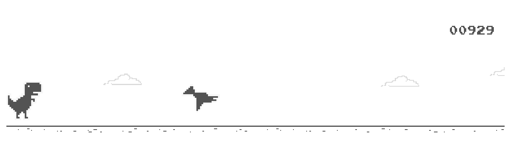

# Dino NEAT

Динозаврик из Chrome T-Rex Runner, которого **обучает нейроэволюция (NEAT)**.
Сеть видит препятствия и сама решает, когда прыгнуть, а когда пригнуться.

Обученный агент проходит **15 000 шагов без единой смерти** — на всех проверочных
сидах, включая те, на которых он не обучался.

<p align="center">
  
</p>

<p align="center"><em>Обученный агент в режиме <code>--play</code>: впереди птеродактиль.</em></p>

---

## Быстрый старт

```bash
# 1. зависимости
python3 -m pip install -r requirements.txt
python3 -m playwright install chromium

# 2. показать обученного динозавра
python3 dino.py --play
```

Всё. Откроется окно браузера, динозавр начнёт играть сам и будет играть,
**пока не столкнётся** — предела в 15 000 шагов у показа нет.

Когда игра закончится, в терминале появится одна строка:

```
шагов: 18342
```

---

## Как это работает

```
dino.py
├── JS_EPISODE      быстрая симуляция: тот же движок игры, но с
│                   фиксированным шагом времени (без ожидания кадров)
├── build_net_spec  переносит геном NEAT в плоский список узлов для JS
├── Trainer         цикл поколений: оценка → отбор → размножение → мутации
├── JS_PLAY_INSTALL автопилот для показа: решение на каждом кадре движка
└── JS_PLAY_VIEW    оформление окна: полная картинка, масштаб под окно
```

**Почему обучение быстрое.** Обычно игра идёт по `requestAnimationFrame` —
60 кадров в секунду реального времени, то есть 15 000 шагов это 4 минуты
на один забег. В симуляции время заменено фиксированным шагом `1000/60` мс,
`requestAnimationFrame` заглушён, а отрисовка отключена. Физика, столкновения
и генерация препятствий остаются **кодом самой игры**, поэтому политика,
обученная в симуляции, работает и в настоящем браузере.

**Почему показ не «срывается».** В реальном окне кадры приходят с плавающим
интервалом: если машина загружена и кадр запаздывает, `deltaTime` скачком
растягивает физику на несколько кадров вперёд — препятствие проскакивает мимо
решения, и динозавр гибнет случайно. Поэтому в режиме показа часы движка тоже
двигаются фиксированным шагом `1000/60` мс: картинка остаётся плавной (кадры
настоящие), но при просадке fps игра просто слегка замедляется, а не
«перескакивает» в столкновение. Тот же геном, что гибнул на 7 000–9 000 шагах
из-за скачков, после этой правки проходит 15 000+ стабильно.

**Почему результаты честные.** `Math.random` заменён на seeded xorshift32,
поэтому все геномы поколения проходят *одинаковые* препятствия. Геном
оценивается на 6 сидах, в зачёт идёт **минимум** по ним: агент считается
обученным, только если выжил на всех.

**Что видит сеть (8 входов):**

| # | Вход | Смысл |
|---|------|-------|
| 1 | `ttc / 60` | кадров до столкновения с ближайшим препятствием |
| 2 | `height / 90` | высота над землёй |
| 3 | `vy` | вертикальная скорость |
| 4 | `speed` | скорость игры |
| 5 | `is_cactus` | впереди кактус |
| 6 | `bird_low` | впереди низкая птица |
| 7 | `bird_mid` | впереди средняя птица |
| 8 | `bird_high` | впереди высокая птица |

**Выходов два:** прыжок и присед.

**Фитнесс:** `шаги + 5·(пройдено препятствий) + 8·(уклонений)`.
Штрафов нет — награда только за реально пройденное препятствие, к которому
динозавр подошёл в воздухе или в приседе.

---

## Обучение

```bash
python3 dino.py                       # до 15 000 шагов (по умолчанию)
python3 dino.py --target-steps 30000  # другая цель
python3 dino.py --generations 100     # ограничить число поколений
```

Обучение идёт **до достижения цели**, а не до фиксированного числа поколений.
Останавливается, когда чемпион выживает `--target-steps` на всех сидах.
Прервать можно `Ctrl+C` — прогресс сохранится в чекпоинт.

Что происходит при запуске:

1. Запускается один headless-браузер с 3 страницами-симуляторами.
2. Если есть совместимый чекпоинт — обучение продолжится с него.
3. Если есть `best_genome.pkl` — чемпион сразу попадает в популяцию.
4. Иначе популяция засевается архивным геномом (`archive/`).
5. Каждые 5 поколений пишется чекпоинт в `checkpoints/`.

Типичная скорость: ~5–6 секунд на поколение из 30 геномов, цель достигается
примерно за 15 поколений.

---

## Файлы

| Файл | Что это |
|------|---------|
| `dino.py` | вся программа: обучение, симуляция, показ |
| `neat_config.ini` | настройки NEAT: популяция, мутации, 8 входов / 2 выхода |
| `best_genome.pkl` | **обученный чемпион** — его и запускает `--play` |
| `best_steps.txt` | рекорд по числу шагов |
| `checkpoints/` | снимки популяции (поколения 5, 10, 15) |
| `archive/best_genome_6654.pkl` | старый геном-затравка для новой популяции |
| `docs/screenshot.png` | снимок экрана для этого README |

`best_genome.pkl` хранит геном вместе с версией признаков. Если версия
не совпадает с текущей, программа предупредит: сеть ожидает другое число
входов, и поведение будет некорректным.

---

## Требования

- Python 3.10+
- `neat-python`, `playwright` (см. `requirements.txt`)
- Браузер: Chromium от Playwright или установленный Яндекс Браузер

По умолчанию берётся Яндекс Браузер на macOS, если он есть, иначе — Chromium
Playwright. Свой путь можно задать переменной окружения:

```bash
DINO_BROWSER="/Applications/Google Chrome.app/Contents/MacOS/Google Chrome" \
  python3 dino.py --play
```

Игра загружается с `https://wayou.github.io/t-rex-runner/`, поэтому нужен
доступ в интернет (один раз, при старте страницы).

---

## Результат

| Проверка | Результат |
|---|---|
| Обучение | поколение 15, чемпион 15 000 шагов на всех 6 сидах |
| Фитнесс чемпиона | 18 455 |
| Невиданные сиды (8 шт.) | 8/8 по 15 000 шагов, фитнесс 18 445–18 523 |
| Показ в реальном окне | 18 000+ шагов без смертей (забег не ограничен) |

Чемпион проходит всё прыжком: прыжок поднимает динозавра выше любой птицы,
поэтому отдельный присед ему не нужен. Присед сеть освоила, но использует
редко — это допустимая тактика, а не ошибка.

---

## Возможные проблемы

**`best_genome.pkl не найден`** — файл чемпиона отсутствует. Обучите модель:
`python3 dino.py`, либо запустите `--play` из папки с проектом.

**`Executable doesn't exist at ...`** — не установлен браузер:
`python3 -m playwright install chromium`.

**Игра не загрузилась** — нет доступа к `wayou.github.io`. Проверьте интернет
и повторите запуск.

**В окне виден только динозавр в углу** — это была ошибка старой версии
(контейнер игры обрезался до 44 px). В текущей версии картинка полная;
если видите обрезку, обновите `dino.py`.
